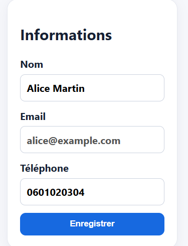

# Bug Report 08 — Impossible de modifier l'adresse e-mail

- Titre : Impossibilité totale de modifier l'adresse e-mail de son compte
- Contexte : Paramètres de sécurité et de profil utilisateur
- Préconditions : Être connecté à son espace personnel.
- Étapes :
  1. Se rendre dans la section de gestion du profil / paramètres du compte.
  2. Cliquer sur le champ de l'adresse e-mail pour tenter de le modifier.
  3. Saisir une nouvelle adresse e-mail valide et sauvegarder.
- Résultat attendu : L'utilisateur doit pouvoir changer son e-mail après validation par mot de passe ou lien de confirmation.
- Résultat obtenu : Le champ est grisé ou verrouillé, rendant toute modification impossible.
- Preuve : Capture d'écran montrant l'interactivité bloquée sur le champ e-mail.
- Sévérité : Élevée
- Priorité : Haute

